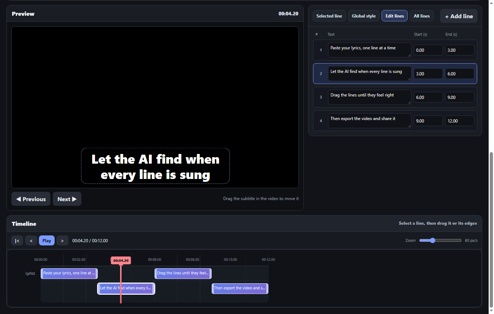

# Lyrics Studio

Make a lyric video in your browser: paste the lyrics, let AI time them to the song, fix the timing on a timeline, and export an MP4.

**Open it: [emmakarapetyan.github.io/Lyrics_Studio](https://emmakarapetyan.github.io/Lyrics_Studio/)**



It is free and needs no account. Your video or song never leaves your device: the AI timing and the video export run inside the browser.

## How to use

1. **Choose a video or a song** (MP4, MP3, WAV, M4A). A song without video becomes a video with the lyrics on a black background.
2. **Paste the lyrics**, one subtitle line per line. Section tags such as `[Chorus]` are skipped.
3. **Time the lines**, in one of three ways:
   - **Time with AI** finds when each line is sung. It works with any language, including Armenian. The first time, the browser downloads a 300 MB model, which can take a few minutes; after that it is kept.
   - **Tap along** plays the song while you hold a button (or Space) during each line. It takes one listen and is the most exact way, also at 0.75× or 0.5× speed. Select a line first to redo only the part from there.
   - **Split evenly** gives every line the same length, so you can set the times yourself.
4. **Play the video and fix what is off:**
   - drag a line on the timeline to move it, or drag its edges to change when it starts and ends
   - on a phone, tap a line first, then drag it
   - **Start here** and **End here** use the current video position
   - drag the subtitle in the preview to move it on the screen
   - **Split**, **Delete** and **+ Add line** change the lines, and **Undo** fixes mistakes
5. **Click Export High Quality Video.** The browser plays the whole song while recording it, then converts it to MP4. Keep the tab open and visible until the download starts.

Your work is saved in the browser automatically. If you close the tab, open the page again and choose the same video. To continue on another device, use **Save project** and **Open project**.

### Keyboard shortcuts

| Key | Action |
|---|---|
| Space | Play or pause |
| ← / → | Previous or next line |
| Shift + ← / → | Move 1 second back or forward |
| Delete | Delete the selected line |
| Space or Enter (hold) | During Tap along: the line is being sung |
| Ctrl+Z / Ctrl+Y | Undo or redo |

### Tips

- AI timing works best with clear vocals. If your song tool (for example Suno) gives you the vocals as a separate file, add it under **Have the vocals as a separate file?** The AI then listens to the vocals only, and the video still uses the full song.
- After AI timing, the status line names the lines the AI was unsure about. Check those first.
- The lyrics must match what is sung, including repeated choruses, because the AI places exactly the lines you give it.
- Export works best in Chrome or Edge on a computer. A phone is fine for editing, but exporting a long video on a phone can be slow or run out of memory.

## How it works

- **AI timing is forced alignment, not transcription.** The lyrics are already known, so the app only has to find *when* each letter is sung. [Meta's MMS aligner](https://huggingface.co/onnx-community/mms-300m-1130-forced-aligner-ONNX) (wav2vec2, trained on more than 1000 languages) runs in the browser with [transformers.js](https://github.com/huggingface/transformers.js) and gives, for every 20 ms of audio, the probability of each Latin letter. The lyrics are written in Latin letters (Armenian and Cyrillic letters by how they sound), and a CTC Viterbi alignment finds the most likely timing of exactly those letters (`align.js`).
- **Why not Whisper:** the first version transcribed the song with Whisper and then matched the words to the lyrics. On Armenian songs Whisper recognised too little for any line to match, so every line fell back to an even split.
- **Export:** each frame of the video and its subtitle is drawn on a canvas and recorded with MediaRecorder as H.264. [FFmpeg compiled to WebAssembly](https://github.com/ffmpegwasm/ffmpeg.wasm) then adds the sound from the original file and writes the MP4, which takes seconds. Browsers that can only record WebM (Firefox) need a full conversion, which is much slower.
- **Code:** `index.html` (layout), `styles.css`, `app.js` (the editor) and `align.js` (romanization and CTC alignment). There is no build step and no server code.

## Run it locally

Browsers block the app's modules when `index.html` is opened directly as a file, so start a small local server in this folder:

```text
python -m http.server 8765
```

Then open `http://localhost:8765`.

To try it on a phone on the same Wi-Fi network, start the server with `--bind 0.0.0.0` and open `http://<your computer's IP address>:8765` on the phone. If the phone cannot connect, allow Python through the Windows Firewall.

Every push to `main` publishes the site with GitHub Pages (see `.github/workflows/pages.yml`).

## License

MIT. See [LICENSE](LICENSE).
